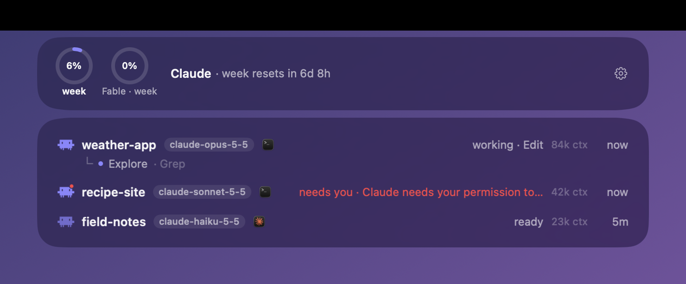

# Claude Widget

A menu bar companion for Claude Code, for anyone who runs long Claude sessions and wants to know their status at a glance, and answer Claude without hunting for the right window.



Claude Code sessions run in a terminal or app you might not be watching. Claude Widget mirrors them in the menu bar: a critter that walks while Claude works, pulses with a red dot when Claude needs you, sits idle when a session is open but Claude is quiet, and sleeps when nothing is running. Rest the pointer on the notch, or click the critter, and a Liquid Glass hub drops out of the notch with every live session (state, model, the app it runs in, current tool, elapsed time, context use, subagents), your Claude usage limits, and any permission prompt waiting for you. Requires macOS 26 (Tahoe) or later.

States at a glance:

- Your theme color (Claude orange by default), walking: Claude is working.
- Pulsing with a red dot: Claude needs you (permission or input).
- Your theme color, dimmer, idle: a session is open and Claude is ready, or waiting after it finishes.
- Dim gray: asleep, no sessions.
- A little Santa hat on the critter from Dec 15 to Jan 7 (turn it off in Settings).
- Rest on the notch: the hub opens after a short pause, so brushing past doesn't open it. It never takes keyboard focus.

Claude Code hooks invoke a small compiled `claude-widget-hook` binary that writes one JSON file per session under `~/.claude/claude-widget/state/`, and one per subagent under `~/.claude/claude-widget/state/subagents/`. The app watches those directories and drives the critter and the hub. Session state never leaves your Mac and there is no telemetry; the only network calls are the two optional features below (Claude limits, and phone alerts if you turn them on).

## Answer from the notch
When Claude asks permission and you're in another app, a pill drops from the notch with Allow and Deny. Allow is offered only when you can see the whole request: file edits and non-ASCII requests get Open and Deny, long commands wrap in exact columns with `↪` and `␣` markers so nothing hides at a line break, and anything taller than 10 rows or partly scrolled out of view gets Open or Review instead. If the session's own app is in front, or comes to the front, the widget steps aside and Claude asks the normal way. Auto mode approves most actions itself; only the prompts it escalates reach the notch.

## Claude limits
The hub shows your Claude usage limits from Anthropic's usage feed, the same numbers as claude.ai's usage page (for example "week 78 %" and "Fable · week 100 %"). How it handles your sign-in:

- Terminal Claude needs to be signed in once (`claude`, then `/login`). On first run the widget copies that sign-in into its own Keychain entry (`Claude Widget-usage-credentials`) and from then on renews its own copy, about every 8 hours. It never writes Claude Code's own Keychain entry.
- Renewing replaces the shared renewal key, so terminal Claude asks for `/login` again the next time it needs to renew.
- The usage and renewal endpoints (`api.anthropic.com/api/oauth/usage`, `platform.claude.com/v1/oauth/token`) are undocumented and may change. If they do, the hub shows "Limits unavailable" and nothing else is affected.
- Tokens only ever go to Anthropic, are never logged, and are never written to a file; `~/.claude/claude-widget/limits.json` holds numbers only. Settings, Limits, Show Claude limits turns it all off (a renewal already in flight still finishes saving, so a renewed sign-in is never lost).

## Now playing
Whatever macOS lists as Now Playing (Spotify, Music, a browser tab, a podcast) gets a card in the hub, between Limits and your sessions: artwork, title, "Artist · App", a progress bar, and back, play/pause and next. Click the artwork or title to bring the app forward. While it plays and the hub is closed, the notch widens a little: the artwork on its left, four level bars in your theme color on its right. Click it to open the hub, or rest on it with Open on hover on. The strip leaves 3 seconds after the music pauses or stops, and steps aside for the hub, any alert, and full-screen apps. It only appears on a display with a notch; nothing playing means no card and no strip.

- macOS answers Now Playing only to Apple's own processes, so the widget reads it through Apple's `/usr/bin/perl`, the method from [mediaremote-adapter](https://github.com/ungive/mediaremote-adapter) (BSD 3-Clause, by Jonas van den Berg), vendored from the [ejbills fork](https://github.com/ejbills/mediaremote-adapter) under `Vendor/MediaRemoteAdapter/` with its license.
- A macOS update could switch this off. Then the card and strip simply don't appear, and Settings may say "Not available on this version of macOS."
- What's playing never leaves your Mac and is never logged. No permission prompt. Settings, Music turns the card off (and the perl process with it), or only the strip around the notch.

## Stack
Swift, SwiftUI (Liquid Glass), AppKit, Swift Package Manager. macOS 26 or later.

## Status
Active, November 2026.

## Getting started
[Download the latest release](https://github.com/glebstarchikov/claude-widget/releases/latest): get the `.dmg`, open it and drag Claude Widget to Applications. The download is built for Macs with Apple silicon. It isn't notarized by Apple, so macOS blocks it the first time you open it: go to System Settings, Privacy & Security, and under Security choose Open Anyway, then enter your login password ([Apple's steps](https://support.apple.com/guide/mac-help/mh40616/mac)). Then install hooks as described below.

Or build it yourself on a Mac:

```sh
scripts/bundle.sh --install
```

This builds `Claude Widget.app`, installs it to `/Applications`, and launches it. The critter shows in the menu bar. Then right-click the critter, choose Settings…, and under Hooks choose Install hooks (this backs up `~/.claude/settings.json` first, then merges the hook entries additively, keeping your existing hooks). Every hook runs in the background except `PermissionRequest`, which waits for the widget only while it's running, you're not in the session's app, and the pill or hub is visible, at most 30 seconds. With the widget not running it adds about 10 ms.

Settings (right-click the critter): Launch at login; Appearance (theme color, New Year hat); Open on hover, Show alerts proactively, Answer permission prompts; Show Claude limits; Music (what's playing, and around the notch); phone alerts via [ntfy](https://ntfy.sh) (only the project folder name leaves your Mac); Install or Remove hooks.

Build and core tests (the commands CI runs):

```sh
swift build
swift test
```

`swift build` compiles the app and the hook. `swift test` runs the core logic tests. Success is a run with no failures.

Develop locally:

```sh
swift run ClaudeWidget        # run unbundled (menu bar icon only shows from a bundled .app, so use bundle.sh for the real thing)
scripts/simulate.sh           # replay a fake session lifecycle, no tokens burned (the app has to be running)
scripts/simulate.sh finished  # the long-task "Finished" alert
scripts/simulate.sh approve   # a permission pill through the real hook (variants: bash, multiline, edit, mcp)
```

`scripts/simulate.sh` expects a debug build of the hook (`swift build`).

Flags for a bundled build, `"build/Claude Widget.app/Contents/MacOS/Claude Widget" <flag>` after `scripts/bundle.sh`:

```sh
-nowPlayingPreview YES        # a fake playing track with artwork, no perl and no music needed
-nowPlayingPreview sparse     # one with no artist, no artwork and no duration
--now-playing-check           # print the adapter's dylib and script paths and one read of the current track, then exit
```

To uninstall: in Settings choose Remove hooks, quit the app, delete `/Applications/Claude Widget.app` and `~/.claude/claude-widget`, then remove the widget's sign-in with `security delete-generic-password -s "Claude Widget-usage-credentials"`.

## License
MIT, see [LICENSE](LICENSE). The license covers this project's code only. The critter and the Claude Code logo are Anthropic trademarks and are not licensed here; this is an unofficial personal tool, not affiliated with Anthropic.

---
Part of what I build at [glebstarchikov.nl](https://glebstarchikov.nl).
